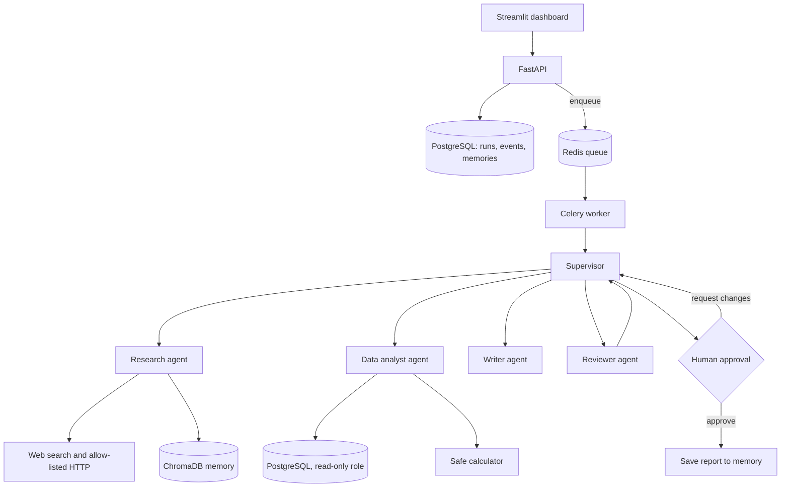

# OrchestrAI - Multi-Agent Orchestration System

A supervisor agent plans a goal, delegates work to specialised agents (research, data analysis, writing, review),
lets them use real tools, remembers past work, and **stops for a human's approval** before anything is finalised.

> Most agent projects are single-agent demos. This one focuses on what production agent systems need:
> supervisor delegation, tool safety, persistent memory, a job queue, and human-in-the-loop escalation.

<!-- Add a screenshot after running it:   -->

## Architecture



**A run, step by step**

1. You submit a goal in the dashboard (`POST /runs`). The API stores it in PostgreSQL and queues a Celery task in Redis.
2. A worker starts the LangGraph state machine. The **supervisor** (an LLM) writes a plan; code validates it so the
   plan is always `research and/or analyst -> writer -> reviewer`.
3. Each agent runs a tool-use loop with **only the tools it needs**, on the model you assigned to it (Claude or GPT-4o).
4. The **reviewer** fact-checks the draft. A deterministic check also rejects any cited URL that never appeared in the
   research. Rejected drafts go back to the writer (up to `MAX_REVISIONS`), then **escalate to a human**.
5. The run pauses at the **approval gate** with its full state in PostgreSQL. A human approves or requests changes
   (with feedback) in the dashboard; the run resumes exactly where it stopped.
6. On approval the report is saved to **persistent memory** (PostgreSQL + ChromaDB) so future runs can reuse it.

## Features

| Area | What you get |
|---|---|
| Orchestration | LangGraph state machine, LLM-planned but code-enforced supervisor routing |
| Agents | Research, Data Analyst, Writer, Reviewer - each with its own model and tool subset |
| Tools | Web search (Tavily), read-only PostgreSQL, safe calculator, allow-listed HTTP, memory search/save |
| Memory | PostgreSQL (source of truth) + ChromaDB (semantic recall), auto-saved after approval |
| Queue | Redis + Celery; runs survive worker restarts because state is saved after every step |
| Human-in-the-loop | Approval gate, request-changes loop, automatic escalation when the reviewer keeps rejecting |
| Multi-provider | OpenAI and Anthropic in the same run; `LLM_OVERRIDE` forces a single model if you only have one key |
| Frontend | Streamlit dashboard: runs, agent cards, activity timeline, approvals, memory, tools |

## Quickstart (Docker)

Requires Docker Desktop and API keys.

```bash
git clone https://github.com/Thanoj012/agent-orchestration-system.git
cd agent-orchestration-system
cp .env.example .env            # Windows: copy .env.example .env   - then add your keys
docker compose up --build
```

Open **http://localhost:8501**, then:

```bash
docker compose exec worker python -m app.cli seed-memory   # optional: demo memories
```

1. **New run** - keep the sample goal, click *Start run*.
2. **Runs** - watch the agent cards and timeline update.
3. **Approvals** - read the draft, then *Approve* or *Request changes*.
4. **Memory** - the approved report is now searchable.

API docs: http://localhost:8000/docs

Keys you need: `ANTHROPIC_API_KEY` and `OPENAI_API_KEY` (or just one plus `LLM_OVERRIDE`), and `TAVILY_API_KEY`
for web search (free tier). Without Tavily the research agent reports that search is unavailable.

### Try it without the dashboard

```bash
docker compose up -d postgres redis chroma
pip install -r requirements.txt
python -m app.cli run "Prepare the Q2 2025 product report"     # asks for approval in the terminal
```
(For local runs set `DATABASE_URL`, `ANALYST_DATABASE_URL`, `CHROMA_PORT=8001` as shown in `.env.example`.)

## The demo scenario

`db/init.sql` seeds a fictional company database (`product_metrics`, `support_tickets`) for three products across
four quarters. The default goal asks for a quarterly product report, so the analyst queries real rows, the
researcher looks up market context on the web, and the writer combines both. All company data is fictional.

## Design decisions

| Decision | Why |
|---|---|
| Supervisor is a pure function of saved state | The run can pause at the approval gate for days, survive a crash, and resume without in-memory state. |
| LLM plans, code enforces the plan shape | A bad or malicious plan can never skip the writer or the reviewer. |
| State persisted after every node | Progress is visible in the dashboard and a redelivered Celery task continues instead of restarting. |
| `TOOL:` / `FINAL:` text protocol | Works the same on Claude and GPT, and long Markdown answers never break JSON escaping. |
| SQL in three layers | Validator, `READ ONLY` transaction with timeout, and a `SELECT`-only database role. |
| AST-based calculator | No `eval`; expressions are parsed and only arithmetic/whitelisted functions run. |
| Least-privilege tools | The reviewer has none; the writer cannot query the database; HTTP only to allow-listed hosts. |
| Deterministic source check | Cited URLs must appear in the research output - the reviewer model is not trusted blindly. |
| Prompt-injection aware | Tool output is labelled untrusted and agents are told never to follow instructions inside it. |
| Row lock on approvals | Double clicks cannot apply two decisions to one request. |

## Project layout

```
app/
  orchestration/  state, planner, supervisor routing, LangGraph builder, runner
  agents/         tool loop, prompts, verification, agent factory
  tools/          calculator, sql guard, search, http, memory tools, catalog
  memory/         PostgreSQL + ChromaDB memory store
  main.py         FastAPI      worker.py  Celery      cli.py  command line
ui/streamlit_app.py            dashboard
db/init.sql                    demo data + read-only role
tests/                         unit tests (no databases, no API keys)
```

## Testing

```bash
pip install -r requirements-dev.txt
pytest -q
```

The suite covers the supervisor logic, the full graph flow with fake agents (happy path, revision loop, escalation,
human change requests, failure, resume), the tool loop protocol, SQL guard, calculator, allow-lists and source
verification. CI runs it on every push. The database, Celery and Streamlit layers are not unit tested; try them with
`docker compose up`.

## Limitations and next steps

- Agents run one after another; independent agents (research and analysis) could run in parallel via one Celery task each.
- Tool calls use a text protocol; native provider tool-calling would be a drop-in replacement in `agents/loop.py`.
- No authentication or per-user permissions on the API and dashboard.
- Schema is created with `create_all`; a real deployment would use Alembic migrations.
- A "Pause" control and a React frontend are natural additions.

## License

MIT
